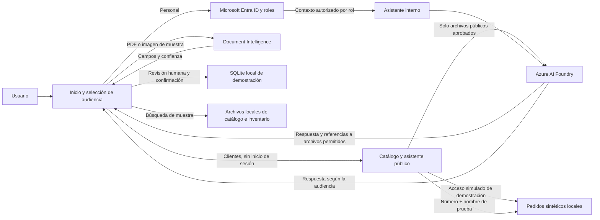

# Arquitectura detallada — demostración escolar

## Componentes utilizados

- **Frontend:** Streamlit.
- **Identidad:** soporte OIDC de Streamlit con Microsoft Entra ID para personal y roles internos. El seguimiento de pedidos usa acceso genérico simulado por nombre; no autentica a personas y solo se usa con datos sintéticos.
- **Facturas:** Streamlit envía el archivo cargado a Azure AI Document Intelligence (`prebuilt-invoice`); solo proveedor, RFC de proveedor/cliente, cliente, folio, subtotal, total e IVA se evalúan para confianza. Si es inferior a 80% o no está disponible, requieren confirmación humana. Después de confirmar como vigente, el usuario puede guardar campos y confianzas en SQLite local (`.demo-data/facturas.sqlite3`); el archivo de origen no se almacena.
- **Asistentes:** el asistente público de clientes muestra categorías del catálogo junto al chat y solo recibe catálogo, horarios y política de devoluciones; el asistente interno recibe los archivos `.txt` locales permitidos por rol. Ambos envían el contexto autorizado al modelo configurado en Azure AI Foundry, mantienen historiales separados por audiencia y muestran referencias a archivos citados por el modelo, validadas contra los documentos enviados.
- **Catálogo e inventario:** archivos de muestra locales, de solo lectura.
- **Pedidos:** un acceso simulado por nombre consulta solo ejemplos sintéticos de `data/pedidos_demo.json`. No autentica personas ni permite consultar datos reales; el asistente también responde a consultas con número de pedido y nombre de prueba.

## Flujos

## Servicios complementarios y publicación

- **Azure AI Search:** no escanea facturas. La extracción de facturas corresponde a Document Intelligence. Search serviría para indexar y recuperar contenido documental, pero no está conectado a los asistentes actuales.
- **Azure Speech:** no forma parte automáticamente de la configuración del agente de Foundry. La aplicación implementa captura, transcripción y síntesis con el recurso F0 existente `rio-claro-speech`, configurado aparte del chat de texto con Foundry. El usuario confirmó que el chat de voz funciona en las experiencias de clientes y empleados, con envío automático al detener la grabación e intento de reproducción automática. El audio de entrada no se persiste; el uso del recurso puede generar cargos variables y no se aprovisionó otro recurso.
- **Azure Storage y base de datos empresarial:** no se usan.
- **SQLite local:** almacena únicamente los campos de facturas confirmadas explícitamente en la base de demostración; no es un servicio empresarial ni está incluido en el repositorio.
- **Azure App Service:** aplicación publicada en Linux Basic B1 en West US. El sitio HTTPS respondió HTTP 200 en la verificación registrada el 1 de noviembre de 2026 UTC. El plan tiene un costo estimado de USD 0.018/h (aprox. USD 13.14 por 730 horas); impuestos, telemetría y otros servicios no están incluidos.

Se verificó la cuenta administradora. El usuario confirmó que cerró sesión de
Entra ID en varias ocasiones y tuvo que autenticarse nuevamente para acceder a
la información protegida. Las pruebas separadas de `obrero` y `finanzas` se
omitieron por decisión del usuario y no se reportan como realizadas. Consulta
el [informe de avance](./avance-proyecto.md) y el detalle en
`../infra/deployment.md`.
