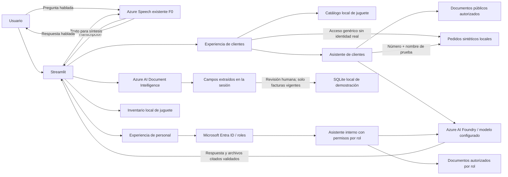

# Arquitectura de la demostración

## Servicios usados

- Azure AI Document Intelligence: análisis de facturas de ejemplo.
- Azure AI Foundry: respuestas separadas para clientes y personal.
- Microsoft Entra ID: acceso de personal por rol. El seguimiento de pedidos usa acceso genérico simulado para datos sintéticos.

## Publicación y estado

La aplicación está desplegada en Azure App Service Linux Basic B1 en West US.
El sitio HTTPS respondió HTTP 200 en la verificación registrada el 1 de
noviembre de 2026 UTC. La tarifa estimada del plan es USD 0.018/h (aprox.
USD 13.14 por 730 horas), sin impuestos, telemetría ni consumo de otros
servicios. Se reutiliza Azure Speech F0; su uso puede generar cargos variables.

## Límites

El asistente de clientes recibe solo documentos públicos; el interno recibe documentos autorizados por rol. Ambos muestran referencias a los archivos que el modelo indica como respaldo, restringidas a los documentos enviados. Solo proveedor, RFC del proveedor y cliente, cliente, folio, subtotal, total e IVA se evalúan para confianza; menos de 80% o confianza no disponible requiere confirmación humana. Solo facturas confirmadas como vigentes se pueden guardar, de forma explícita, en SQLite local excluida del repositorio. Los pedidos usan ejemplos sintéticos y un acceso simulado que no autentica usuarios; no existe conexión a pedidos reales. El contexto local se pasa completo al modelo; no hay Azure AI Search, índice vectorial ni recuperación por relevancia. Catálogo e inventario son datos de juguete. La voz usa Speech para transcribir y sintetizar; la aplicación no persiste el audio de entrada. El usuario confirmó que cerró sesión de Entra ID y tuvo que volver a iniciar sesión para acceder a la información protegida. Las pruebas separadas de `obrero` y `finanzas` se omitieron por decisión del usuario.

La aplicación es una demostración escolar, no un sistema productivo ni una
validación de beneficios de negocio. Consulta el [informe de avance](./avance-proyecto.md)
para los resultados y pendientes registrados.
