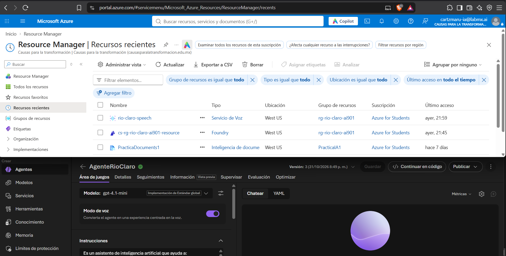
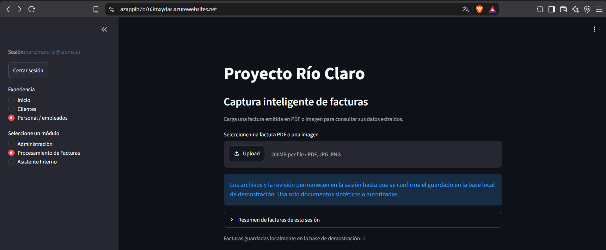
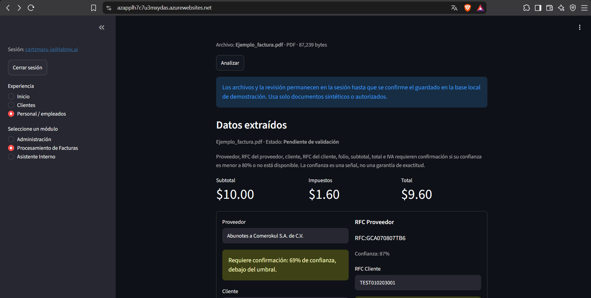
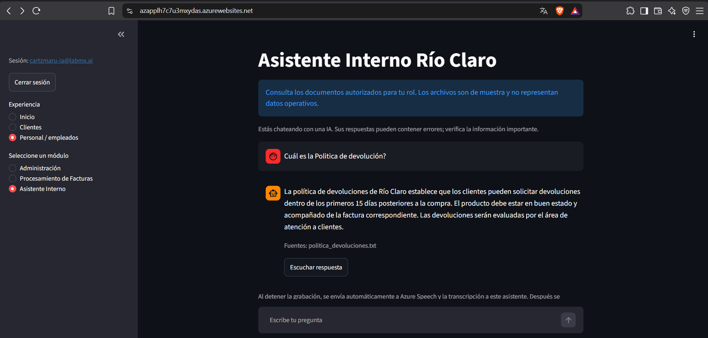
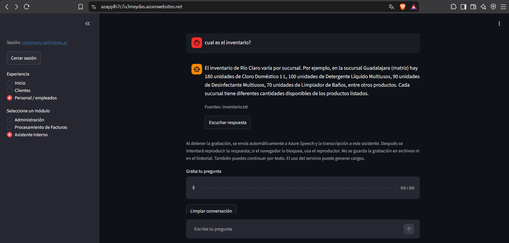
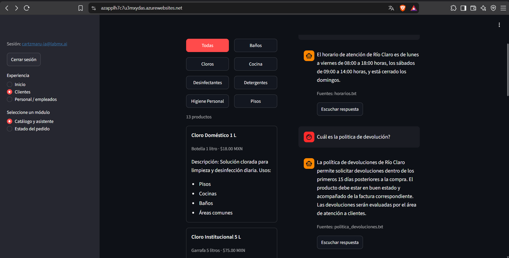
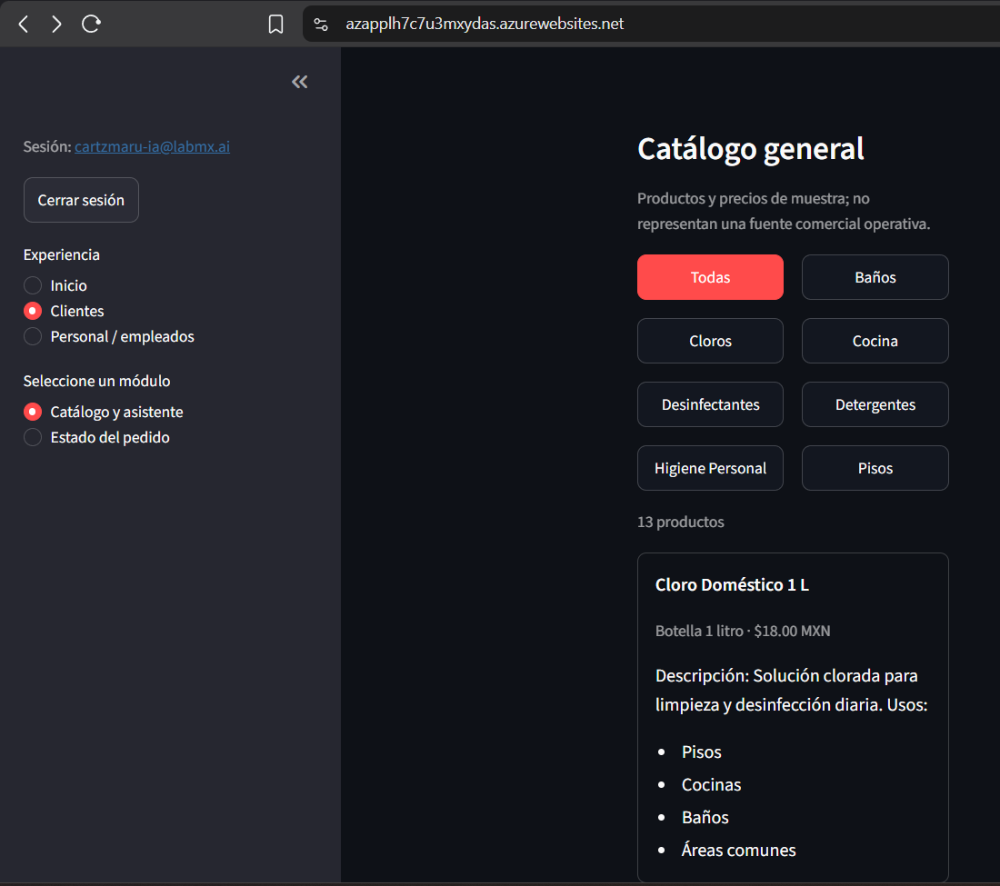
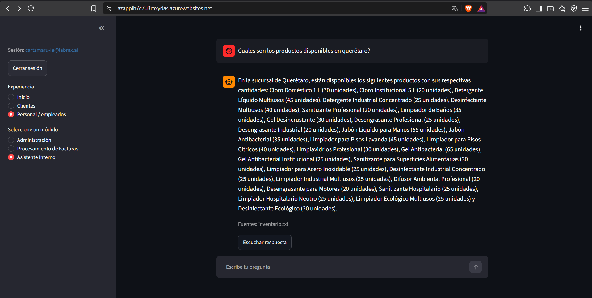
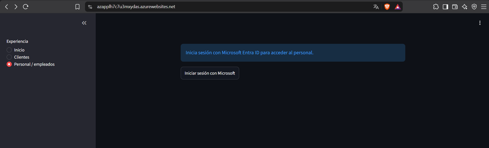
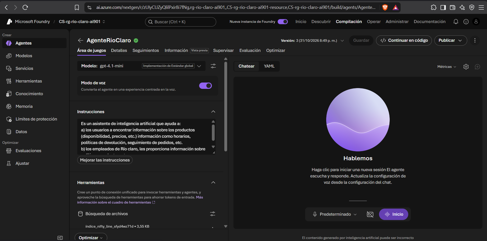

# Proyecto Río Claro

## AI-901: Microsoft Azure AI Fundamentals

### Integrante

Carlos Esteban Sánchez Salas

---

# Resumen Ejecutivo

El proyecto Río Claro tiene como objetivo resolver problemas operativos relacionados con la deficiente digitalización, que los lleva a una captura manual de información proveniente de facturas y la consulta de información empresarial por parte de clientes y colaboradores.

Para atender estas necesidades se desarrolló una solución basada en servicios de Inteligencia Artificial de Microsoft Azure que integra procesamiento documental, inteligencia artificial generativa, gestión del conocimiento empresarial y control de acceso mediante Microsoft Entra ID.

La solución permite automatizar procesos, mejorar la productividad y facilitar el acceso a información relevante mediante una interfaz web desarrollada con Visual Studio Code.

---

# Descripción del Problema

La empresa Río Claro enfrentaba diversos desafíos operativos:

- Captura manual de información de facturas.
- Riesgo de errores humanos en procesos administrativos.
- Dificultad para consultar información de productos, inventario y políticas comerciales.
- Dependencia de personal para responder consultas repetitivas.
- Información distribuida en múltiples documentos.
- Pagos dobles a proveedores.
- Muy lenta atención al cliente.

Estos problemas impactaban la eficiencia operativa y aumentaban los tiempos de respuesta hacia clientes y colaboradores.

---

# Solución Implementada

Se desarrolló una aplicación web inteligente utilizando servicios de Azure AI para automatizar procesos documentales y proporcionar acceso inteligente a la información empresarial.

La solución se compone de:

- Procesamiento automático de facturas.
- Asistente inteligente (tanto para clientes como para empleados).
- Consulta de catálogo de productos.
- Consulta de inventario por sucursal.
- Consulta de documentos empresariales mediante RAG.
- Autenticación empresarial con Microsoft Entra ID.

---

# Tecnologías Utilizadas

## Desarrollo

- Visual Studio Code
- Python
- Streamlit

## Servicios Azure

- Azure AI Foundry
- GPT-4.1-mini
- Azure AI Document Intelligence
- Azure Voice Service
- Microsoft Entra ID

## Capacidades de Inteligencia Artificial

- OCR
- Extracción automática de datos
- IA Generativa
- Retrieval-Augmented Generation (RAG)
- Procesamiento de lenguaje natural

---

# Arquitectura de la Solución

La arquitectura implementada integra procesamiento documental, inteligencia artificial generativa y control de acceso seguro utilizando servicios de Microsoft Azure.



## Flujo General

```text
Usuario
   │
   ▼
Aplicación Streamlit
   │
   ├── Azure AI Document Intelligence
   │
   ├── Azure AI Foundry
   │       └── GPT-4.1-mini
   │
   ├── Catálogo de Productos
   │
   ├── Inventario por Sucursal
   │
   └── Microsoft Entra ID
```

---

# Módulo 1: Procesamiento Inteligente de Facturas

## Objetivo

Automatizar la captura de información contenida en facturas recibidas por la organización.

## Funcionalidad

La aplicación permite cargar:

- PDF
- JPG
- JPEG
- PNG

Posteriormente Azure AI Document Intelligence procesa el documento y extrae automáticamente la información relevante.

## Información Extraída

- Proveedor
- RFC Proveedor
- Cliente
- RFC Cliente
- Folio
- Subtotal
- IVA
- Total

## Evidencia 1. Carga de Factura



La aplicación permite cargar facturas en formato PDF o imagen para su procesamiento mediante Azure AI Document Intelligence.

## Evidencia 2. Resultado de Extracción



La solución identifica automáticamente los principales campos de negocio contenidos en la factura.

---

# Módulo 2: Asistente Inteligente

## Objetivo

Proporcionar una interfaz conversacional para clientes y empleados utilizando Inteligencia Artificial Generativa.

## Tecnología

- Azure AI Foundry
- GPT-4.1-mini

## Capacidades

- Atención a clientes.
- Atención a empleados.
- Respuestas en español.
- Interpretación de lenguaje natural.
- Contexto empresarial.

## Evidencia



### Ejemplo de uso

```text
¿Quién eres?

Soy el asistente virtual de Río Claro...
```

---

# Módulo 3: Consulta de Conocimiento Empresarial (RAG)

## Objetivo

Permitir que el asistente proporcione respuestas basadas en documentos internos autorizados.

## Fuentes de Conocimiento

- Catálogo de productos.
- Inventario por sucursal.
- Política de devoluciones.
- Política de facturas duplicadas y canceladas.
- Información de sucursales.

## Consulta de Inventario



### Ejemplo

```text
¿Cuánto cloro doméstico hay en Guadalajara?
```

La respuesta se genera utilizando información proveniente del inventario empresarial.

## Consulta de Políticas Empresariales



### Ejemplo

```text
¿Cuál es la política para facturas duplicadas?
```

La respuesta se genera utilizando documentación empresarial específica.

---

# Módulo 4: Catálogo de Productos

## Objetivo

Permitir a clientes y colaboradores consultar los productos comercializados por Río Claro.

## Información Disponible

- Nombre del producto.
- Código.
- Categoría.
- Presentación.
- Precio.
- Descripción.
- Casos de uso.

## Evidencia



Actualmente el catálogo incluye más de 30 productos distribuidos en distintas líneas de negocio:

- Limpieza general.
- Sanitización.
- Higiene personal.
- Industria.
- Hotelería.
- Hospitalaria.
- Ecológica.
- Automotriz.

---

# Módulo 5: Inventario por Sucursal

## Objetivo

Los empleados pueden consultar la disponibilidad de productos en las diferentes sucursales de la empresa.

## Sucursales Consideradas

- Guadalajara
- Zapopan
- León
- Querétaro
- Aguascalientes

## Funcionalidades

- Consulta por sucursal.
- Búsqueda por producto.
- Consulta de disponibilidad.
- Identificación de sucursal con existencia.

## Evidencia



La aplicación permite conocer existencias específicas por sucursal y disponibilidad de productos especializados.

---

# Seguridad y Control de Acceso

## Microsoft Entra ID

La solución incorpora autenticación empresarial mediante Microsoft Entra ID.

## Roles Definidos

- Cliente
- Obrero
- Finanzas
- Administrador

Cada rol dispone únicamente de acceso a las funcionalidades correspondientes a sus actividades.

## Evidencia



La autenticación controla el acceso a módulos protegidos y permite la implementación de permisos por perfil.

---

# Azure AI Foundry

La solución utiliza GPT-4.1-mini como modelo principal para capacidades conversacionales y consultas empresariales.

## Funciones Implementadas

- IA Generativa.
- Atención a usuarios.
- Respuestas basadas en conocimiento empresarial.
- Consultas mediante lenguaje natural.

## Evidencia



---

# Política de Facturas Duplicadas y Canceladas

Se definieron reglas de negocio para gestionar documentos fiscales.

## Facturas Vigentes

Se incluyen en reportes operativos, administrativos y financieros.

## Facturas Duplicadas

Son excluidas de cálculos operativos pero conservadas para fines de auditoría.

## Facturas Canceladas

Son excluidas de los procesos operativos y permanecen almacenadas para consulta histórica.

---

# IA Responsable

## Equidad

La solución procesa facturas, consultas y documentos utilizando los mismos criterios para todos los usuarios y proveedores, evitando tratamientos diferenciados o discriminatorios.

## Confiabilidad y Seguridad

La información generada por la IA puede ser revisada y validada por personal autorizado antes de utilizarse en procesos administrativos o financieros.

## Privacidad y Seguridad

Las credenciales y configuraciones sensibles se administran mediante mecanismos seguros y los recursos empresariales se protegen mediante autenticación y autorización.

## Inclusión

La aplicación acepta múltiples formatos de entrada y facilita el acceso a diferentes perfiles de usuario.

## Transparencia

El sistema identifica claramente cuándo utiliza información proveniente de documentos empresariales o facturas procesadas.

## Responsabilidad

Las decisiones finales continúan siendo responsabilidad de los usuarios de Río Claro, utilizando la IA como una herramienta de apoyo.

---

# Beneficios para Río Claro

La solución desarrollada proporciona los siguientes beneficios:

- Reducción de captura manual de información.
- Disminución de errores administrativos.
- Mayor velocidad de atención a clientes y colaboradores.
- Acceso centralizado al conocimiento empresarial.
- Consulta rápida de inventario y catálogo.
- Automatización de procesos documentales.
- Control de acceso mediante Microsoft Entra ID.
- Base tecnológica escalable para futuras mejoras.

---

# Resultados Obtenidos

La solución permitió:

- Automatizar la captura de información de facturas.
- Reducir tareas manuales.
- Facilitar consultas empresariales.
- Centralizar información relevante para clientes y empleados.
- Incorporar capacidades de IA Generativa.
- Implementar control de acceso mediante Microsoft Entra ID.
- Homologar la información y facilitar la generación de reportes.

---

# Conclusiones

El proyecto Río Claro demuestra cómo los servicios de Inteligencia AI Foundry, GPT-4.1-mini, Copilot-Visual Code y Microsoft Entra ID permitió construir una solución funcional capaz de mejorar la productividad, reducir errores operativos y facilitar el acceso a información empresarial.

Además, se incorporaron principios de Inteligencia Artificial Responsable y una arquitectura escalable que permite futuras mejoras como integración con sistemas empresariales, reportes avanzados y capacidad de alimentar con más documentos a los asistentes por voz.

Como resultado, la organización dispone de una plataforma moderna que demuestra el potencial de la Inteligencia Artificial como herramienta para la transformación digital y la mejora continua de los procesos empresariales.

---

# Anexos

## Evidencias Generadas

Las evidencias visuales utilizadas durante el desarrollo y validación del proyecto se encuentran en:

```text
docs/imagenes/
```

### Archivos incluidos

- arquitectura.png
- factura-carga.png
- factura-extraccion.png
- chat-general.png
- catalogo-productos.png
- inventario-sucursal.png
- rag-inventario.png
- rag-politicas.png
- login-entra-id.png
- foundry-modelo.png

Las imágenes anteriores fueron utilizadas directamente dentro de las secciones correspondientes del documento para evitar duplicidad de evidencias.